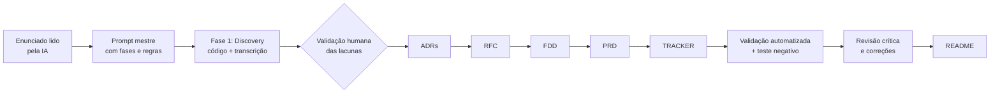

# Da Reunião ao Documento: Design Docs Gerados por IA

Entrega do desafio do módulo **Design Docs com IA** (MBA em Engenharia de Software com IA). O enunciado original está no [repositório base](https://github.com/devfullcycle/mba-ia-desafio-design-docs-com-ia).

## Sobre o desafio

Uma empresa opera um **Order Management System** (Node.js + TypeScript + Express + Prisma/MySQL) e decidiu, numa reunião de ~55 minutos entre Tech Lead, PM, dois engenheiros e a engenheira de segurança, construir um **Sistema de Webhooks de Notificação de Pedidos**. Nada foi registrado além da transcrição ([TRANSCRICAO.md](TRANSCRICAO.md)).

O trabalho foi transformar essa transcrição, mais o código existente, num pacote de design docs acionável: PRD, RFC, FDD, sete ADRs e um tracker de rastreabilidade. A regra central é que **nenhuma informação pode existir sem origem identificável** na transcrição ou no código. Igualmente importante é identificar o que a reunião **descartou ou adiou**: e-mail de alerta, dashboard, rate limiting, ordenação global, múltiplos workers e arquivamento. A entrega é puramente documental: `src/`, `prisma/` e `tests/` não foram alterados.

## Ferramentas de IA utilizadas

| Ferramenta | Papel |
|---|---|
| **Claude Code** (extensão do VS Code), modelo **Claude Opus 5.5** | Agente principal. Leu o repositório e a transcrição inteiros, fez o discovery, redigiu todos os documentos, calculou o vetor de teste HMAC do FDD e escreveu e executou o script de validação |
| **Node.js** (script gerado pela IA, executado localmente) | Verificação automática do pacote: cada `[hh:mm] Nome` citado existe na transcrição, cada caminho de código existe, os links relativos e as âncoras resolvem, e as porcentagens do tracker batem |

## Workflow adotado



1. **Contexto antes de tudo.** Primeiro passei o enunciado completo com a instrução "leia e aguarde", para a IA conhecer os critérios de aceite antes de qualquer geração.
2. **Prompt mestre por fases.** Escrevi um prompt longo definindo a persona (Staff Engineer), princípios (evidence-based, separação de responsabilidades entre documentos, YAGNI) e **10 fases com pontos de parada**. A instrução explícita foi começar **só** pelo discovery.
3. **Discovery com relatório.** A IA listou os ~60 arquivos versionados, leu integralmente os ~40 relevantes (schema Prisma, módulos de pedidos e clientes, erros, middlewares, logger, entry points, configuração e testes) e as 323 linhas da transcrição, e devolveu um inventário classificado:
   - 26 decisões, 11 requisitos funcionais, 5 requisitos não funcionais e 5 restrições;
   - 16 alternativas descartadas, 7 itens fora de escopo e 5 questões em aberto;
   - **16 lacunas** que a reunião não resolveu, cada uma com uma recomendação.
4. **Validação humana.** Revisei as recomendações e aprovei as 6 que dependiam de decisão (detalhes em "Iterações").
5. **Ordem de produção:** ADRs → RFC → FDD → PRD → TRACKER, como sugerido no enunciado. As decisões formaram o esqueleto, e o PRD virou uma consolidação de alto nível.
6. **Validação automatizada e revisão crítica:** script de verificação, teste negativo do próprio script e revisão cruzada entre os documentos.

## Prompts customizados

**Prompt 1: persona e princípios** (trecho do prompt mestre)

```text
Atue como um Staff Software Engineer / Senior Software Architect [...]
Você não deve agir como um simples gerador de documentos.
Você deve pensar, questionar, investigar, identificar inconsistências, avaliar trade-offs,
validar decisões e garantir que cada especificação tenha fundamentação técnica.

## 2.1. Evidence-Based Engineering
Toda decisão, requisito, restrição ou comportamento documentado deve possuir uma origem verificável.
As fontes permitidas são: TRANSCRICAO.md; Código-fonte existente no repositório.
Quando uma informação não estiver disponível, classifique-a como:
Confirmado | Inferido | Proposto | Em aberto | Não identificado.
Nunca transforme uma inferência em decisão confirmada.
```

**Prompt 2: discovery dirigido, antes de gerar qualquer documento** (trecho)

```text
Leia integralmente o arquivo TRANSCRICAO.md. Extraia e classifique:
Decisões fechadas | Requisitos funcionais | Requisitos não funcionais | Restrições |
Alternativas descartadas | Questões abertas | Ideias futuras | Referências ao código.
Para cada informação, registre: Identificador único, Descrição, Categoria, Timestamp,
Participante, Evidência textual ou resumo fiel.
Não confunda uma sugestão individual com uma decisão aprovada pelo grupo.
[...]
Comece exclusivamente pela FASE 1 — DISCOVERY.
Não gere PRD, RFC, FDD ou ADRs antes de entender o código e a transcrição.
```

**Prompt 3: regras do tracker contra alucinação** (trecho)

```text
Regras:
1. Cada requisito deve ter uma origem.  [...]
6. Não invente timestamps.
7. Não utilize caminhos inexistentes.
8. Não atribua decisões a participantes que não as aprovaram.
Quando um item for uma proposta técnica sem origem direta, identifique-o como
inferência ou proposta e não falsifique sua rastreabilidade.
```

O efeito mais visível do prompt 3 foi o tracker ganhar os tipos **Inferência** e **Proposta**. Detalhes técnicos sem decisão na reunião (lease de 60s, formato `sha256=<hex>`, nome `webhook.publisher.ts`) aparecem como propostas, e não como falas de alguém.

## Iterações e ajustes

Foram **4 ciclos principais**: discovery com validação humana, produção com correções durante a escrita, validação automatizada com revisão crítica, e minha revisão final dos documentos contra a transcrição.

**Ciclo 1: lacunas que a reunião deixou e que a IA não podia decidir sozinha.** O discovery mostrou que um "gerar documentos direto" teria escondido ambiguidades. Seis decisões passaram por mim:

- **"5 tentativas" é ambíguo.** Diego listou 5 intervalos (1m/5m/30m/2h/12h) e disse "quase 15 horas entre a primeira falha e a última tentativa". A conta (876 min ≈ 14h36) só fecha com **1 envio inicial + 5 retentativas = 6 requisições**, mas o resumo da Larissa diz "total 5 tentativas". Aprovei a interpretação, que ficou explícita no [ADR-003](docs/adrs/ADR-003-retry-backoff-e-dlq.md).
- **Onde validar os 64KB.** Validar na inserção faria a mudança de status do pedido falhar por um problema de webhook. Decidimos validar no worker e mandar direto para a DLQ.
- **Granularidade da outbox:** uma linha por par (evento, endpoint), para que um cliente fora do ar não atrase o retry de outro.
- **Observabilidade:** a reunião não falou de métricas, e o projeto não tem Prometheus nem OpenTelemetry. Introduzir essas ferramentas violaria o "nada de infra nova" ([09:07] Diego). A seção de observabilidade foi feita com logs Pino estruturados e consultas SQL, e tudo nela está marcado como proposta, exceto a meta de < 10s.
- **Evento na criação do pedido** e **qual secret assina durante a rotação** ficaram como questões em aberto no RFC, em vez de virarem decisões inventadas.
- Conjunto de 7 ADRs: as 6 decisões principais mais o snapshot do payload.

**Ciclo 2: conflitos entre a transcrição e o código, encontrados ao escrever o FDD.**

- **`WEBHOOK_INVALID_URL` contra `validate.middleware.ts`.** Bruno quer o código `WEBHOOK_INVALID_URL` ([09:28]) e Sofia quer a regra no schema Zod ([09:23]). Só que o middleware existente converte **todo** `ZodError` em `VALIDATION_ERROR`. Resolvido sem mexer no middleware (reuso, ADR-006): a resposta sai como `VALIDATION_ERROR`, com o código `WEBHOOK_*` em `details`. A limitação está documentada.
- **`NotFoundError` fixa o código `NOT_FOUND`.** Estender essa classe tornaria impossível o prefixo `WEBHOOK_`, então `WebhookNotFoundError` precisa estender `AppError` direto.
- **A garantia de ordem não é o que parece.** Diego afirma ordem por `order_id` com single-worker ([09:12]), mas com retry um evento em backoff é ultrapassado pelo seguinte do mesmo pedido. Isso não foi tratado como contradição a esconder: virou limitação no ADR-002 e a questão Q-6 no RFC.
- **`WEBHOOK_SECRET_REQUIRED`**, citado como exemplo por Bruno, não se aplica, porque a secret é gerada pela plataforma ([09:31] Marcos). Ficou fora da matriz de erros.
- O exemplo de `X-Signature` no FDD **não é um placeholder**: foi calculado de verdade (HMAC-SHA256 do corpo de 326 bytes mostrado), para servir de vetor de teste.

**Ciclo 3: validação e revisão crítica.**

- Script de validação sobre todo o pacote: 245 linhas no tracker, 360 citações `[hh:mm] Nome` conferidas contra a transcrição, caminhos de código, links e âncoras. Resultado: zero problemas.
- Como "zero problemas" pode significar um validador que não valida, rodei um **teste negativo**: injetei numa cópia uma fala inexistente, uma fala com o falante errado, um arquivo inexistente, uma âncora falsa e uma citação errada. Os 6 erros foram detectados.
- **A cobertura por categoria revelou um buraco no tracker** que a porcentagem global escondia. O FDD define 16 critérios de aceite técnicos e o tracker só tinha 5; também faltavam 3 linhas para os códigos da matriz `WEBHOOK_*`. Foram acrescentadas 14 linhas (de 245 para 259), e o resumo de cobertura passou a ser conferido categoria por categoria. A mesma conferência corrigiu dois números que a IA tinha escrito no resumo antes de medir: eram 13 códigos `WEBHOOK_*` distintos, não 14, e 21 propostas, não 24.
- A revisão cruzada achou uma **inconsistência real no FDD**. A §12.3 mandava logar o enfileiramento *depois do commit*, mas a §15 dizia que `changeStatus` só ganharia uma linha. Corrigido: a §15 agora explica que é preciso guardar os `eventIds` e importar o logger em `order.service.ts`.

**Ciclo 4: minha revisão final contra a transcrição.**

- **Contagem de tentativas no ADR-003.** Ao revisar o ADR-003, questionei a interpretação "1 envio inicial + 5 retentativas = 6 requisições". Ela parecia contradizer o resumo da Larissa ([09:48]: "total 5 tentativas"), que se soma a [09:15] e [09:17], onde o Diego fala em cinco tentativas e cinco intervalos.
- Pedi à IA para confrontar essa leitura com a transcrição. A conferência mostrou que, no vocabulário da reunião, "tentativa" significa **retentativa**. Contar o envio inicial dentro das 5 tornaria falsas três falas do Diego: "cinco cobre 12 ou 24 horas" ([09:15]), "retentaria três vezes em 30 minutos" ([09:16]) e "quase 15 horas" ([09:17]). Também deixaria o intervalo de 12h sem uso.
- **Resultado:** a decisão foi mantida, mas a justificativa estava fraca e a redação induzia a erro. Ela se apoiava só em [09:17] e destacava "6 requisições", que soa como contradição. O ADR-003 foi reescrito no vocabulário da reunião ("5 tentativas de retry após o envio inicial"), com uma tabela de evidências. O tracker ganhou 3 linhas para [09:15] Diego, [09:16] Diego e [09:48] Larissa.

Prompt usado:

```text
ADR-003 — Retry
- [09:15] Diego propõe cinco tentativas.
- [09:17] Diego apresenta cinco intervalos: 1m, 5m, 30m, 2h e 12h.
- [09:48] Larissa confirma explicitamente total de cinco tentativas.
```

- **Revisão de segurança e confiabilidade.** Fiz uma revisão técnica de todo o pacote com uma lista de 4 grupos de pontos: concorrência no worker, SSRF, rotação de secrets, isolamento entre clientes, confiabilidade, evoluções de produto e perguntas em aberto. Pedi à IA para confrontar cada ponto com os documentos e com a transcrição antes de mudar qualquer coisa. O resultado foi triado em três grupos:
  - **Já cobertos:** estados explícitos com `locked_at` e lease, claim atômico, histórico preservado na DLQ, `event_id` preservado no replay, batch configurável, índice composto e `next_attempt_at`. Ganharam apenas o FDD-AC-17, que testa o cenário "o worker cai depois do 2xx".
  - **Lacunas reais, incorporadas como proposta da revisão:**
    - **SSRF** virou o FDD §11.1, com severidade crítica: lista de faixas bloqueadas, validação no cadastro e no envio, IP pinning contra DNS rebinding e regra de egress. Um efeito colateral técnico importante: o cliente HTTP do worker trocou o `fetch` por `node:https`, porque o `fetch` nativo não permite controlar o DNS sem o pacote `undici`, e isso quebraria a regra de "nada de dependência nova".
    - Criptografia da secret em repouso (§11.2) e auditoria do CRUD e da rotação (§11.4).
    - Leitura da resposta limitada a 4 KB.
    - Novo erro `WEBHOOK_DESTINATION_BLOCKED`.
    - Três questões em aberto no RFC: Q-9 (SSRF), Q-10 (retry por status HTTP) e Q-11 (versionamento).
    - Duas evoluções futuras no PRD, saúde do endpoint e evento de teste, marcadas como não discutidas.
  - **Conflito com a reunião:** o isolamento entre clientes, que eu considerava prioridade alta, contradiz [09:37] Sofia (CRUD aberto "por enquanto"). Também não é implementável hoje, porque `User` não tem vínculo com `Customer` no schema. Ficou como **recomendação**, pré-condição antes de dar a usuários de clientes acesso à API, e não como requisito (§11.3 e RFC Q-4).
  - Todas as linhas novas do tracker usam o tipo **"Proposta (revisão humana)"**, para não serem confundidas com decisões da reunião.

## Como navegar a entrega

| Ordem | Documento | Para quê |
|---|---|---|
| 1 | [docs/PRD.md](docs/PRD.md) | Problema, clientes, escopo e o que ficou de fora, requisitos e métricas |
| 2 | [docs/RFC.md](docs/RFC.md) | Proposta técnica em 3–4 páginas, alternativas descartadas e questões em aberto |
| 3 | [docs/adrs/](docs/adrs/README.md) | Uma decisão por arquivo: [001 Outbox](docs/adrs/ADR-001-outbox-no-mysql.md) · [002 Worker](docs/adrs/ADR-002-worker-separado-em-polling.md) · [003 Retry/DLQ](docs/adrs/ADR-003-retry-backoff-e-dlq.md) · [004 HMAC](docs/adrs/ADR-004-hmac-sha256-com-secret-por-endpoint.md) · [005 At-least-once](docs/adrs/ADR-005-entrega-at-least-once-com-x-event-id.md) · [006 Reuso](docs/adrs/ADR-006-reuso-dos-padroes-do-projeto.md) · [007 Snapshot](docs/adrs/ADR-007-payload-snapshot-na-insercao.md) |
| 4 | [docs/FDD.md](docs/FDD.md) | Como construir: modelo de dados, fluxos, 8 contratos HTTP, matriz `WEBHOOK_*`, observabilidade e **integração com 17 arquivos do código** (§15) |
| 5 | [docs/TRACKER.md](docs/TRACKER.md) | Origem de cada item na transcrição (`[hh:mm] Nome`) ou no código |

Quem vai implementar pode ir direto ao FDD §7 (fluxos), §8 (contratos) e §15 (integração), e consultar os ADRs quando precisar do "porquê".
