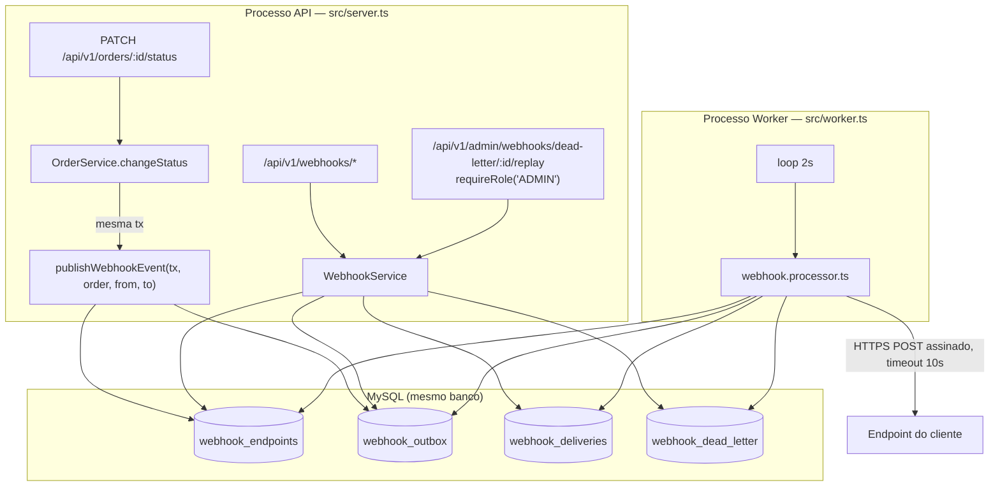
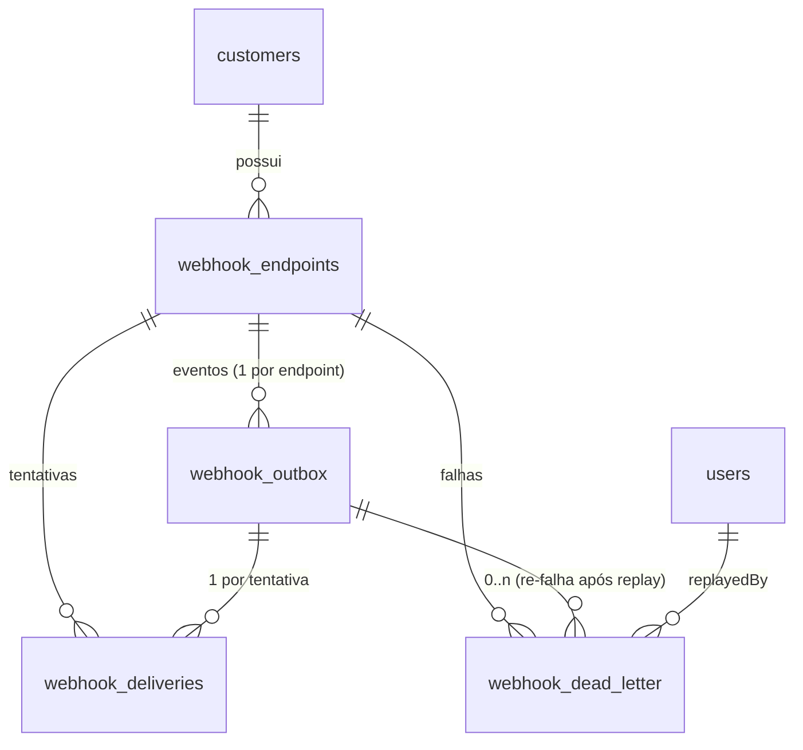
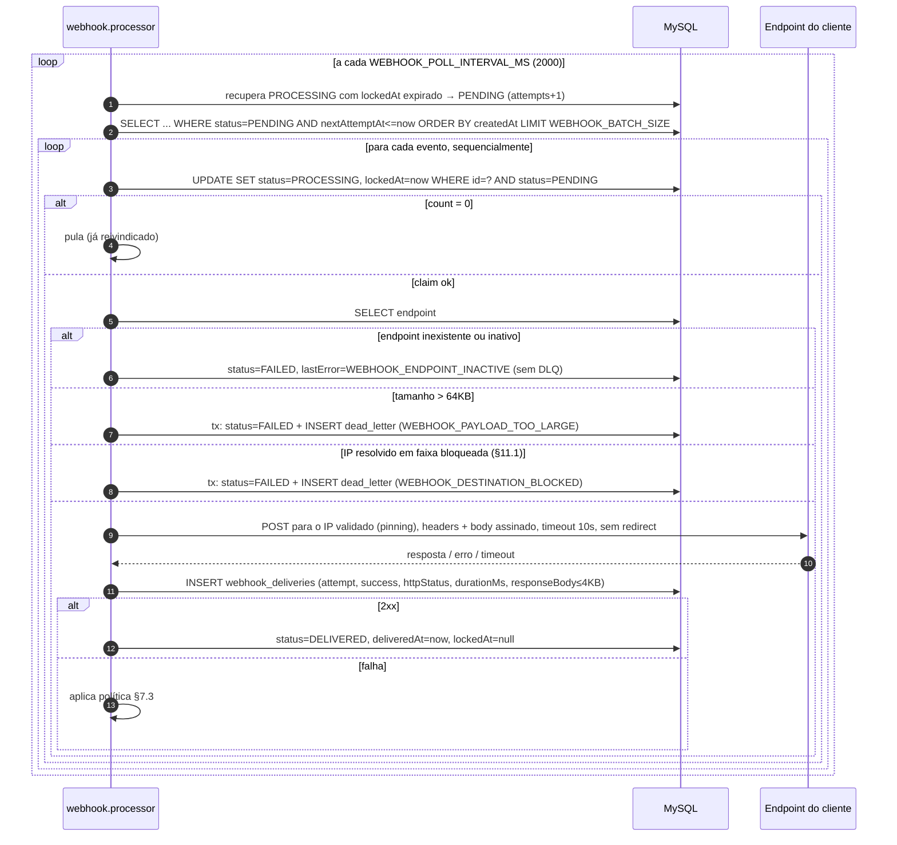
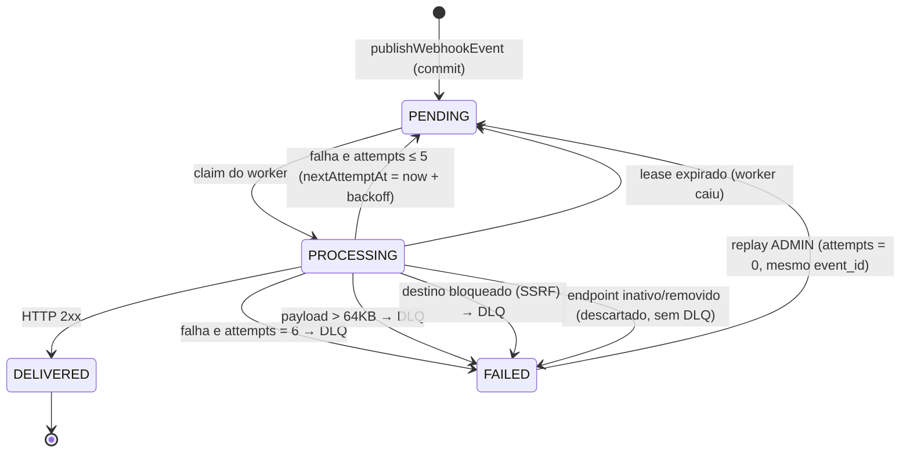

# FDD — Sistema de Webhooks de Notificação de Pedidos

| Campo | Valor |
|---|---|
| **Status** | Pronto para implementação (sujeito às questões em aberto do [RFC §7](RFC.md#7-questões-em-aberto)) |
| **Data** | 2026-11-16 |
| **Responsáveis técnicos** | Larissa (TL), Bruno (Pedidos), Diego (Plataforma); Sofia revisa segurança |
| **Base** | [RFC](RFC.md), [ADR-001 a ADR-007](adrs/README.md) |

> **Convenção de rastreabilidade:** `[hh:mm] Nome` remete a [TRANSCRICAO.md](../TRANSCRICAO.md). Itens marcados **(proposta)** são detalhamentos técnicos sem decisão explícita na reunião. Foram derivados para tornar o documento implementável e são rastreados no [TRACKER](TRACKER.md).

---

## 1. Contexto e motivação técnica

`OrderService.changeStatus` ([src/modules/orders/order.service.ts:126-179](../src/modules/orders/order.service.ts#L126-L179)) executa, dentro de um único `prisma.$transaction`:

1. leitura do pedido com os itens;
2. validação da transição (`canTransition`, em [order.status.ts](../src/modules/orders/order.status.ts));
3. débito ou reposição de estoque;
4. `order.update` do status;
5. `orderStatusHistory.create` (auditoria).

Não há nenhum mecanismo de notificação externa. Os clientes B2B fazem polling em `GET /orders` ([09:00] Marcos).

A feature precisa enviar notificações a sistemas externos não confiáveis sem:

- aumentar o tempo da transação de pedidos;
- criar inconsistência entre "status mudou" e "evento existe" ([09:04] Bruno, [09:06] Diego).

Daí as decisões de outbox transacional, worker separado, retry com DLQ, HMAC e at-least-once (ADR-001 a ADR-005).

## 2. Objetivos técnicos

| ID | Objetivo | Origem |
|---|---|---|
| OT-01 | Registrar o evento atomicamente com a mudança de status: commit implica evento, rollback implica nenhum evento | [09:06] Diego, [09:40] Bruno |
| OT-02 | Entregar ao cliente em **< 10s** no caminho feliz (polling de 2s + envio) | [09:02] Marcos, [09:10] Larissa |
| OT-03 | Nenhuma chamada HTTP externa dentro da transação de pedidos | [09:04] Bruno |
| OT-04 | Tolerar indisponibilidade do cliente por até ~14h36 antes da DLQ | [09:17] Diego |
| OT-05 | Toda requisição assinada com HMAC-SHA256 com secret por endpoint | [09:22] Sofia |
| OT-06 | Zero infraestrutura nova e zero dependências npm novas | [09:07] Diego, [09:29] Bruno |

## 3. Escopo e exclusões

**Incluso**

- tabelas de configuração, outbox, entregas e DLQ;
- `publishWebhookEvent` integrado a `changeStatus`;
- worker em `src/worker.ts`;
- CRUD de webhooks, rotação de secret, histórico de entregas e replay administrativo da DLQ;
- assinatura, retry, timeouts, logs e métricas.

**Excluído**

| Item | Motivo | Origem |
|---|---|---|
| Webhooks de entrada | Só saída | [09:02] Marcos |
| E-mail de alerta ao cliente | Adiado para a próxima fase | [09:37] Larissa |
| Dashboard visual | Projeto do time de frontend | [09:40] Larissa |
| Arquivamento/limpeza da outbox (> 30 dias) | Fora desta feature | [09:08] Diego |
| Rate limiting de saída | "Observar e decidir depois" | [09:39] Larissa |
| Múltiplos workers / particionamento | Futuro | [09:13] Diego |
| Ordenação global de eventos | Não exigida pelos clientes | [09:14] Marcos |
| Evento na **criação** do pedido (`null → PENDING`) | Não discutido; só `changeStatus` (RFC Q-7) | Código: `order.service.ts#create` |
| Listagem e replay em massa da DLQ | Não discutido; só replay por id | [09:18] Diego |

## 4. Arquitetura proposta



## 5. Componentes

| Componente | Arquivo (novo) | Responsabilidade | Origem |
|---|---|---|---|
| Rotas | `src/modules/webhooks/webhook.routes.ts` | `buildWebhookRouter`, `buildWebhookAdminRouter` | [09:27] Bruno |
| Controller | `src/modules/webhooks/webhook.controller.ts` | Adaptação HTTP no mesmo padrão de `OrderController` | [09:27] Bruno |
| Service | `src/modules/webhooks/webhook.service.ts` | CRUD, rotação de secret, deliveries, replay | [09:27] Bruno |
| Repository | `src/modules/webhooks/webhook.repository.ts` | Acesso Prisma às 4 tabelas | [09:27] Bruno |
| Schemas | `src/modules/webhooks/webhook.schemas.ts` | Zod: URL HTTPS, statuses, params | [09:23] Sofia, [09:30] Larissa |
| Publisher | `src/modules/webhooks/webhook.publisher.ts` **(proposta de nome)** | `publishWebhookEvent(tx, …)`: filtro + snapshot + insert | [09:41] Bruno |
| Processor | `src/modules/webhooks/webhook.processor.ts` | Ciclo de polling, entrega, retry, DLQ | [09:28] Bruno |
| Signer | `src/modules/webhooks/webhook.signature.ts` **(proposta)** | Geração de secret e HMAC | [09:20] Sofia |
| Entry point | `src/worker.ts` | Bootstrap, loop e graceful shutdown | [09:11] Larissa |

## 6. Modelo de dados



Esboço Prisma a acrescentar em [prisma/schema.prisma](../prisma/schema.prisma). Todos os ids são UUID ([09:51] Larissa):

```prisma
enum WebhookOutboxStatus {
  PENDING      // pendente   [09:08] Diego
  PROCESSING   // processando
  DELIVERED    // entregue
  FAILED       // falhou → existe registro em webhook_dead_letter, ou descartado (endpoint inativo)
}

model WebhookEndpoint {
  id                      String    @id @default(uuid()) @db.Char(36)
  customerId              String    @db.Char(36)                 // [09:21] Bruno
  url                     String    @db.VarChar(2048)            // https obrigatório [09:23] Sofia
  secret                  String    @db.VarChar(255)             // por endpoint [09:21] Sofia; cifrada AES-256-GCM (§11.2)
  previousSecret          String?   @db.VarChar(255)             // rotação [09:21] Sofia; cifrada (§11.2)
  previousSecretExpiresAt DateTime?                              // now + 24h
  statuses                Json                                   // ex.: ["SHIPPED","DELIVERED"] [09:33] Marcos
  active                  Boolean   @default(true)               // [09:21] Bruno
  createdAt               DateTime  @default(now())
  updatedAt               DateTime  @updatedAt

  customer    Customer            @relation(fields: [customerId], references: [id], onDelete: Cascade)
  outbox      WebhookOutbox[]
  deliveries  WebhookDelivery[]
  deadLetters WebhookDeadLetter[]

  @@index([customerId, active])
  @@map("webhook_endpoints")
}

model WebhookOutbox {
  id                String              @id @db.Char(36)   // = event_id = X-Event-Id, gerado na aplicação [09:25] Diego
  webhookEndpointId String              @db.Char(36)
  orderId           String              @db.Char(36)       // sem FK: snapshot independe do ciclo de vida do pedido
  eventType         String              @db.VarChar(64)    // "order.status_changed"
  payload           Json                                   // snapshot [09:52] Larissa
  status            WebhookOutboxStatus @default(PENDING)
  attempts          Int                 @default(0)        // tentativas que falharam
  nextAttemptAt     DateTime            @default(now())    // backoff (proposta)
  lockedAt          DateTime?                              // lease de PROCESSING (proposta)
  lastError         String?             @db.VarChar(500)
  deliveredAt       DateTime?
  createdAt         DateTime            @default(now())
  updatedAt         DateTime            @updatedAt

  endpoint WebhookEndpoint @relation(fields: [webhookEndpointId], references: [id], onDelete: Cascade)

  @@index([status, createdAt])      // [09:08] Diego
  @@index([status, nextAttemptAt])  // proposta: seleção de elegíveis
  @@index([orderId])
  @@map("webhook_outbox")
}

model WebhookDelivery {                                     // histórico [09:34] Marcos
  id                String   @id @default(uuid()) @db.Char(36)
  outboxId          String   @db.Char(36)
  webhookEndpointId String   @db.Char(36)
  attempt           Int                                     // 1..6
  success           Boolean
  httpStatus        Int?
  durationMs        Int
  errorCode         String?  @db.VarChar(64)                // WEBHOOK_*
  responseBody      String?  @db.Text                       // truncado em 4 KB (proposta)
  createdAt         DateTime @default(now())

  endpoint WebhookEndpoint @relation(fields: [webhookEndpointId], references: [id], onDelete: Cascade)

  @@index([webhookEndpointId, createdAt])
  @@index([outboxId])
  @@map("webhook_deliveries")
}

model WebhookDeadLetter {                                   // [09:18] Diego
  id                String    @id @default(uuid()) @db.Char(36)
  outboxId          String    @db.Char(36)
  webhookEndpointId String    @db.Char(36)
  payload           Json
  errorCode         String    @db.VarChar(64)
  reason            String    @db.VarChar(500)
  attempts          Int
  failedAt          DateTime  @default(now())
  replayedAt        DateTime?
  replayedById      String?   @db.Char(36)                  // auditoria [09:36] Sofia

  endpoint   WebhookEndpoint @relation(fields: [webhookEndpointId], references: [id], onDelete: Cascade)
  replayedBy User?           @relation("DeadLetterReplayedBy", fields: [replayedById], references: [id])

  @@index([webhookEndpointId])
  @@index([failedAt])
  @@map("webhook_dead_letter")
}
```

**Decisões de modelagem**

- **Uma linha de outbox por par (evento, endpoint)** ([ADR-001](adrs/ADR-001-outbox-no-mysql.md)), com `id` = `event_id`.
- **`DELETE` de webhook remove em cascata** outbox, entregas e DLQ do endpoint. Os eventos pendentes de um endpoint removido deixam de existir, e é isso que se espera.
- `statuses` é uma coluna `Json`. O filtro é feito em memória no publisher (o customer tem poucos endpoints).
- `Customer` e `User` recebem as relações inversas (`webhookEndpoints`, `replayedDeadLetters`).

## 7. Fluxos detalhados

### 7.1 Criação do evento na outbox

```mermaid
sequenceDiagram
  autonumber
  participant C as Operador (API)
  participant OS as OrderService.changeStatus
  participant PUB as publishWebhookEvent
  participant DB as MySQL (tx)
  C->>OS: PATCH /api/v1/orders/:id/status {toStatus}
  OS->>DB: BEGIN; SELECT order + items
  OS->>OS: canTransition(from, to)
  OS->>DB: debit/replenish stock (se aplicável)
  OS->>DB: UPDATE orders.status
  OS->>DB: INSERT order_status_history
  OS->>PUB: publishWebhookEvent(tx, order, from, to)
  PUB->>DB: SELECT webhook_endpoints WHERE customerId AND active
  PUB->>PUB: filtra endpoints cujo statuses contém to
  alt nenhum endpoint interessado
    PUB-->>OS: [] (nada inserido) [09:34] Bruno
  else 1..n endpoints
    PUB->>DB: INSERT webhook_outbox (1 linha por endpoint, payload snapshot)
    PUB-->>OS: eventIds
  end
  OS->>DB: COMMIT (ou ROLLBACK de tudo se qualquer passo falhar)
  OS-->>C: 200 pedido atualizado
```

Assinatura (proposta de tipagem; o nome e os parâmetros vêm de [09:41] Bruno):

```ts
// src/modules/webhooks/webhook.publisher.ts
export async function publishWebhookEvent(
  tx: Prisma.TransactionClient,
  order: Pick<Order, 'id' | 'orderNumber' | 'customerId' | 'totalCents'>,
  fromStatus: OrderStatus,
  toStatus: OrderStatus,
): Promise<string[]> // ids (event_id) inseridos
```

Regras:

1. Seleciona `webhookEndpoint.findMany({ where: { customerId: order.customerId, active: true } })`.
2. Mantém só os endpoints com `statuses.includes(toStatus)` ([09:34] Bruno).
3. Para cada endpoint, gera `eventId = uuidv4()` (pacote `uuid`, já no projeto) e monta o payload ([§8.1](#81-contrato-de-saída-requisição-enviada-ao-cliente)) com `timestamp = new Date().toISOString()`.
4. Grava com `tx.webhookOutbox.createMany(...)`, com `status = PENDING`, `attempts = 0` e `nextAttemptAt = now`.
5. **Não captura exceções.** Qualquer erro sobe e o `$transaction` faz rollback de tudo ([09:40] Bruno).
6. **Não faz I/O fora do `tx`** e **não valida tamanho**: os 64KB são verificados no worker ([ADR-003](adrs/ADR-003-retry-backoff-e-dlq.md)).

### 7.2 Processamento pelo worker



Detalhes:

- **Ordem:** `ORDER BY createdAt ASC` e processamento **sequencial** dentro do lote. Isso dá a ordem por `order_id` no caminho feliz com single-worker ([09:12] Diego).
- **Lote pequeno** ([09:08] Diego): `WEBHOOK_BATCH_SIZE = 10` **(proposta)**.
- **Claim condicional:** o `UPDATE ... WHERE status = PENDING` evita que um segundo worker iniciado por engano envie o mesmo evento em paralelo. **Não** restaura a garantia de ordem.
- **Lease (proposta):** linhas em `PROCESSING` com `lockedAt < now − WEBHOOK_PROCESSING_LEASE_MS` (60s, maior que os 10s de timeout) são consideradas interrompidas (o worker caiu) e voltam à política de falha com `WEBHOOK_DELIVERY_INTERRUPTED`. Isso conta como tentativa, para evitar loop infinito com um evento que derruba o worker.
- **Sem sobreposição de ciclos:** o próximo ciclo só é agendado (`setTimeout`) depois que o atual termina.
- **A URL e a secret são lidas no momento do envio**; o payload vem do snapshot. Uma mudança de URL via `PATCH` vale também para os eventos pendentes.
- **Montagem da requisição:**
  - `body = JSON.stringify(payload)`;
  - `X-Signature` sobre esses bytes exatos;
  - cliente HTTP: `node:https.request`, nativo e sem dependência nova, com uma função `lookup` customizada. Ela resolve o DNS, valida cada IP contra as faixas bloqueadas e conecta **no IP validado** (§11.1). O `fetch` nativo foi descartado porque não permite controlar a resolução DNS sem instalar o pacote `undici`;
  - redirects não são seguidos (`https.request` não segue redirect);
  - **timeout total de 10s**, cobrindo conexão, TLS, cabeçalhos e corpo da resposta, via `signal: AbortSignal.timeout(10_000)` ([09:42] Diego);
  - **corpo da resposta lido em stream até 4 KB**. Ao atingir o limite, `res.destroy()` descarta o restante, para que respostas grandes não consumam memória do worker **(proposta da revisão)**;
  - `new https.Agent({ keepAlive: true, lookup })` reutiliza conexões entre envios ao mesmo host. Cada socket novo passa pela validação **(proposta da revisão)**;
  - sucesso = **status 200–299** (proposta). Qualquer 3xx, 4xx ou 5xx é falha retentável. A classificação por status (4xx não retentável, `Retry-After` em 429) está em aberto no RFC Q-10.

### 7.3 Retry e backoff

```ts
// proposta: constante em webhook.processor.ts — valores de [09:17] Diego
export const RETRY_DELAYS_MS = [60_000, 300_000, 1_800_000, 7_200_000, 43_200_000]; // 1m 5m 30m 2h 12h
export const MAX_ATTEMPTS = 1 + RETRY_DELAYS_MS.length; // 6 requisições
```

Quando uma tentativa falha:

```
attempts = attempts + 1
se attempts <= 5:
  status = PENDING; nextAttemptAt = now + RETRY_DELAYS_MS[attempts - 1]; lockedAt = null; lastError = <código>
senão:
  → DLQ (§7.4) com errorCode = WEBHOOK_MAX_ATTEMPTS_EXCEEDED e reason = último erro
```

| Requisição | Quando (a partir da 1ª tentativa T0) | Se falhar |
|---|---|---|
| #1 (inicial) | T0, ≤ ~2s após o commit | agenda +1m |
| #2 | T0 + 1m | agenda +5m |
| #3 | T0 + 6m | agenda +30m |
| #4 | T0 + 36m | agenda +2h |
| #5 | T0 + 2h36m | agenda +12h |
| #6 | T0 + 14h36m | **DLQ** |

Cada envio pode atrasar até ~2s em relação ao horário agendado, por causa do polling. Não há jitter: com um único worker, não existe "thundering herd" a evitar.



### 7.4 DLQ e replay

**Entrada na DLQ** (em uma transação):

- `webhook_outbox.status = FAILED`, `lockedAt = null`;
- `INSERT webhook_dead_letter { outboxId, webhookEndpointId, payload, errorCode, reason, attempts, failedAt }`;
- log `webhook_moved_to_dlq` (nível `warn`) com `deadLetterId`, que é como o ADMIN descobre o id para o replay, já que não há listagem nesta fase.

**Replay** (`POST /api/v1/admin/webhooks/dead-letter/:id/replay`, [§8.8](#88-post-apiv1adminwebhooksdead-letteridreplay)), em uma transação:

1. `webhook_dead_letter.updateMany({ where: { id, replayedAt: null }, data: { replayedAt: now, replayedById: req.user.id } })`. Se `count = 0` e o registro existe, retorna `409 WEBHOOK_DLQ_ALREADY_REPLAYED`.
2. `webhook_outbox.update({ status: PENDING, attempts: 0, nextAttemptAt: now, lockedAt: null, lastError: null })`, **mantendo o mesmo `id`/`event_id`** ([ADR-005](adrs/ADR-005-entrega-at-least-once-com-x-event-id.md)).
3. Log `webhook_dlq_replayed` com `userId` ([09:36] Sofia).

Se o evento falhar de novo, ele percorre o ciclo completo e gera **uma nova linha** na DLQ. O histórico de falhas é preservado.

### 7.5 Rotação de secret

1. `previousSecret = secret`, `previousSecretExpiresAt = now + 24h`, `secret = nova` ([09:21] Sofia).
2. Enquanto `now < previousSecretExpiresAt`, o worker envia **(proposta, RFC Q-5)**: `X-Signature: sha256=<hmac(secret)>,sha256=<hmac(previousSecret)>`.
3. Depois de expirar, o worker ignora `previousSecret`. A limpeza da coluna acontece na próxima rotação.
4. Uma nova rotação durante o grace period substitui `previousSecret` pela secret atual. Só existe **uma** secret anterior por vez **(proposta)**.

## 8. Contratos públicos

Todas as rotas da API ficam sob o prefixo `/api/v1` ([src/app.ts](../src/app.ts)). Na reunião elas foram citadas sem o prefixo. Autenticação: `Authorization: Bearer <JWT>` ([src/middlewares/auth.middleware.ts](../src/middlewares/auth.middleware.ts)). Erros seguem o envelope de [error.middleware.ts](../src/middlewares/error.middleware.ts):

```json
{ "error": { "code": "WEBHOOK_NOT_FOUND", "message": "Webhook not found" } }
```

Status codes comuns a todas as rotas: `401 UNAUTHORIZED` (token ausente ou inválido), `400 VALIDATION_ERROR` (schema Zod), `500 INTERNAL_SERVER_ERROR`.

### 8.1 Contrato de saída (requisição enviada ao cliente)

`POST <url cadastrada>`

| Header | Valor | Origem |
|---|---|---|
| `Content-Type` | `application/json` | [09:44] Diego |
| `X-Event-Id` | UUID do evento, estável entre retries e replay | [09:25] Diego |
| `X-Webhook-Id` | UUID do endpoint cadastrado | [09:44] Sofia |
| `X-Timestamp` | Instante do **envio**, em ISO 8601 (muda a cada tentativa) | [09:44] Diego |
| `X-Signature` | `sha256=<hex>` = HMAC-SHA256(secret, corpo bruto) **(formato: proposta)** | [09:20] Sofia |

Corpo ([09:43] Diego; snapshot, [ADR-007](adrs/ADR-007-payload-snapshot-na-insercao.md)):

```json
{"event_id":"7c9e6679-7425-40de-944b-e07fc1f90ae7","event_type":"order.status_changed","timestamp":"2026-11-16T14:32:05.123Z","order_id":"b8e2f0a4-5c1d-4e7b-9a3f-2d6c8e1f4a90","order_number":"ORD-000123","from_status":"PROCESSING","to_status":"SHIPPED","customer_id":"3f1c9a2e-8b4d-4c6f-a1e3-5d7b9c0e2f41","total_cents":18500}
```

O corpo acima tem 326 bytes. Com a secret de exemplo `whsec_9f2c4e7a1b3d5f60718293a4b5c6d7e8f90112233445566778899aabbccddeef`, a assinatura é:

```
X-Signature: sha256=96c7733cf170bdc4c53d892ac297a526458aef938b030a1650723a2e8f31e247
```

Verificação do lado do cliente (referência para o portal, [09:26] Marcos):

```ts
import { createHmac, timingSafeEqual } from 'node:crypto';
const expected = 'sha256=' + createHmac('sha256', secret).update(rawBody).digest('hex');
const ok = signatureHeader.split(',').some((s) =>
  s.trim().length === expected.length && timingSafeEqual(Buffer.from(s.trim()), Buffer.from(expected)));
```

**Semântica da resposta do cliente**

| Resposta do cliente | Interpretação |
|---|---|
| 2xx | Entregue |
| 3xx, 4xx, 5xx | Falha retentável |
| Sem resposta em 10s | Falha retentável (`WEBHOOK_DELIVERY_TIMEOUT`) |
| Erro de DNS/TCP/TLS | Falha retentável (`WEBHOOK_DELIVERY_NETWORK_ERROR`) |

O corpo da resposta é ignorado, exceto para gravar até 4 KB no histórico.

**Valores possíveis de `to_status`:** `PAID`, `PROCESSING`, `SHIPPED`, `DELIVERED`, `CANCELLED`, que são os destinos alcançáveis em `changeStatus` segundo [order.status.ts](../src/modules/orders/order.status.ts). `PENDING` só ocorre na criação, que não emite evento (§3).

### 8.2 `POST /api/v1/webhooks`

Cadastra um webhook ([09:31] Marcos). Qualquer role autenticada ([09:37] Sofia).

Request:

```json
{
  "customerId": "3f1c9a2e-8b4d-4c6f-a1e3-5d7b9c0e2f41",
  "url": "https://hooks.atlas.example.com/oms/orders",
  "statuses": ["SHIPPED", "DELIVERED"]
}
```

Validações (Zod em `webhook.schemas.ts`):

- `customerId`: UUID (no body; RFC Q-2).
- `url`: `z.string().url().max(2048)`, com refinamento de protocolo `https:` ([09:23] Sofia).
- `statuses`: array não vazio, sem repetição, de `PAID | PROCESSING | SHIPPED | DELIVERED | CANCELLED`.

Regras:

- O customer precisa existir.
- O destino da URL passa pela validação contra SSRF no service (§11.1). É rejeitado com `422 WEBHOOK_DESTINATION_BLOCKED` se o host for `localhost`, um IP literal em faixa bloqueada ou um nome que resolva para uma dessas faixas **(proposta da revisão)**. A checagem fica no service, e não no Zod, porque exige resolução DNS assíncrona, e o `validate()` existente usa `parse` síncrono.
- A secret é gerada pela plataforma ([09:31] Marcos) com `crypto.randomBytes(32)`, no formato `whsec_<64 hex>` **(proposta)**, e gravada cifrada (§11.2).
- `active = true`.
- URLs duplicadas para o mesmo customer não são bloqueadas (não discutido).

Response `201 Created` (**única** resposta, junto com a rotação, que contém a secret):

```json
{
  "id": "a41d6e2b-0c7f-4b9e-8d35-6f1a2b3c4d5e",
  "customerId": "3f1c9a2e-8b4d-4c6f-a1e3-5d7b9c0e2f41",
  "url": "https://hooks.atlas.example.com/oms/orders",
  "statuses": ["SHIPPED", "DELIVERED"],
  "active": true,
  "secret": "whsec_9f2c4e7a1b3d5f60718293a4b5c6d7e8f90112233445566778899aabbccddeef",
  "createdAt": "2026-11-16T14:00:00.000Z",
  "updatedAt": "2026-11-16T14:00:00.000Z"
}
```

| Status | Quando |
|---|---|
| 201 | Criado |
| 400 `VALIDATION_ERROR` | Body inválido; URL não-HTTPS traz `details: [{ "path": "url", "message": "WEBHOOK_INVALID_URL: url must use https" }]` |
| 401 `UNAUTHORIZED` | Sem JWT válido |
| 404 `WEBHOOK_CUSTOMER_NOT_FOUND` | `customerId` inexistente |
| 422 `WEBHOOK_DESTINATION_BLOCKED` | URL aponta para rede interna, loopback, link-local ou multicast (§11.1) |

### 8.3 `GET /api/v1/webhooks?customerId={uuid}&page=1&pageSize=20`

Lista os webhooks de um customer ([09:33] Bruno). `customerId` é obrigatório; paginação no padrão de [response.ts](../src/shared/http/response.ts). **Nunca retorna `secret`.**

Response `200 OK`:

```json
{
  "data": [
    {
      "id": "a41d6e2b-0c7f-4b9e-8d35-6f1a2b3c4d5e",
      "customerId": "3f1c9a2e-8b4d-4c6f-a1e3-5d7b9c0e2f41",
      "url": "https://hooks.atlas.example.com/oms/orders",
      "statuses": ["SHIPPED", "DELIVERED"],
      "active": true,
      "previousSecretExpiresAt": null,
      "createdAt": "2026-11-16T14:00:00.000Z",
      "updatedAt": "2026-11-16T14:00:00.000Z"
    }
  ],
  "pagination": { "page": 1, "pageSize": 20, "total": 1, "totalPages": 1 }
}
```

| Status | Quando |
|---|---|
| 200 | Sucesso (lista vazia se o customer não tem webhooks) |
| 400 `VALIDATION_ERROR` | `customerId` ausente ou não-UUID |
| 401 `UNAUTHORIZED` | Sem JWT válido |

### 8.4 `PATCH /api/v1/webhooks/:id`

Edita o webhook ([09:33] Bruno). Campos opcionais, mas **pelo menos um** é obrigatório. `customerId` não é editável.

Request:

```json
{ "statuses": ["PAID", "SHIPPED", "DELIVERED", "CANCELLED"], "active": true }
```

Response `200 OK`: mesmo formato de um item de §8.3, sem a secret.

Efeitos:

- `statuses` vale **apenas para eventos futuros**, porque o filtro é aplicado na inserção.
- `active=false` faz com que eventos já pendentes sejam descartados no envio (`WEBHOOK_ENDPOINT_INACTIVE`).
- Uma nova `url` vale também para os pendentes (§7.2).

| Status | Quando |
|---|---|
| 200 | Atualizado |
| 400 `VALIDATION_ERROR` | Body vazio ou inválido (inclui `WEBHOOK_INVALID_URL` em `details`) |
| 422 `WEBHOOK_DESTINATION_BLOCKED` | Nova `url` aponta para destino bloqueado (§11.1) |
| 401 `UNAUTHORIZED` | Sem JWT válido |
| 404 `WEBHOOK_NOT_FOUND` | Id inexistente |

### 8.5 `DELETE /api/v1/webhooks/:id`

Remove o webhook ([09:33] Bruno). Remove em cascata eventos pendentes, histórico e DLQ do endpoint (§6).

Response `204 No Content` (sem corpo).

| Status | Quando |
|---|---|
| 204 | Removido |
| 401 `UNAUTHORIZED` | Sem JWT válido |
| 404 `WEBHOOK_NOT_FOUND` | Id inexistente |

### 8.6 `POST /api/v1/webhooks/:id/rotate-secret`

Gera uma nova secret; a antiga continua válida por 24h ([09:21] Sofia). O caminho da rota é **proposta**. Request sem corpo.

Response `200 OK`:

```json
{
  "id": "a41d6e2b-0c7f-4b9e-8d35-6f1a2b3c4d5e",
  "secret": "whsec_0d1e2f3a4b5c6d7e8f9a0b1c2d3e4f5a6b7c8d9e0f1a2b3c4d5e6f7a8b9c0d1e",
  "previousSecretExpiresAt": "2026-11-17T14:00:00.000Z"
}
```

| Status | Quando |
|---|---|
| 200 | Rotacionada |
| 401 `UNAUTHORIZED` | Sem JWT válido |
| 404 `WEBHOOK_NOT_FOUND` | Id inexistente |

### 8.7 `GET /api/v1/webhooks/:id/deliveries?limit=100`

Histórico de entregas ([09:34] Marcos): as últimas tentativas, com sucesso ou falha, payload, resposta e tempo. `limit` vai de 1 a 100 (padrão 100). Ordenação `createdAt DESC`.

Response `200 OK`:

```json
{
  "data": [
    {
      "id": "e5f6a7b8-1c2d-4e3f-9a0b-1c2d3e4f5a6b",
      "eventId": "7c9e6679-7425-40de-944b-e07fc1f90ae7",
      "attempt": 2,
      "success": true,
      "httpStatus": 200,
      "durationMs": 184,
      "errorCode": null,
      "responseBody": "{\"received\":true}",
      "payload": { "event_id": "7c9e6679-7425-40de-944b-e07fc1f90ae7", "event_type": "order.status_changed", "to_status": "SHIPPED", "...": "..." },
      "createdAt": "2026-11-16T14:33:07.410Z"
    },
    {
      "id": "d4e5f6a7-0b1c-4d2e-8f9a-0b1c2d3e4f5a",
      "eventId": "7c9e6679-7425-40de-944b-e07fc1f90ae7",
      "attempt": 1,
      "success": false,
      "httpStatus": 503,
      "durationMs": 92,
      "errorCode": "WEBHOOK_DELIVERY_HTTP_ERROR",
      "responseBody": "Service Unavailable",
      "payload": { "...": "..." },
      "createdAt": "2026-11-16T14:32:06.002Z"
    }
  ]
}
```

| Status | Quando |
|---|---|
| 200 | Sucesso |
| 400 `VALIDATION_ERROR` | `limit` fora de 1..100 |
| 401 `UNAUTHORIZED` | Sem JWT válido |
| 404 `WEBHOOK_NOT_FOUND` | Id inexistente |

### 8.8 `POST /api/v1/admin/webhooks/dead-letter/:id/replay`

Reprocessa manualmente um evento da DLQ ([09:18] Diego). Exige **`requireRole('ADMIN')`** ([09:36] Sofia, [09:36] Larissa). Request sem corpo.

Response `202 Accepted` (o evento é reenfileirado, não enviado na hora):

```json
{
  "deadLetterId": "c3d4e5f6-9a0b-4c1d-8e2f-3a4b5c6d7e8f",
  "eventId": "7c9e6679-7425-40de-944b-e07fc1f90ae7",
  "status": "PENDING",
  "replayedAt": "2026-11-17T09:10:00.000Z",
  "replayedById": "0a1b2c3d-4e5f-4a6b-8c7d-9e0f1a2b3c4d"
}
```

| Status | Quando |
|---|---|
| 202 | Reenfileirado |
| 401 `UNAUTHORIZED` | Sem JWT válido |
| 403 `FORBIDDEN` | Role diferente de ADMIN (`requireRole` existente) |
| 404 `WEBHOOK_DLQ_ENTRY_NOT_FOUND` | Id de DLQ inexistente |
| 409 `WEBHOOK_DLQ_ALREADY_REPLAYED` | Entrada já reprocessada |
| 422 `WEBHOOK_ENDPOINT_INACTIVE` | O endpoint de destino está inativo (reative via §8.4 antes) |

## 9. Matriz de erros

Prefixo `WEBHOOK_` em todos os códigos do módulo ([09:29] Larissa). As classes ficam em [src/shared/errors/http-errors.ts](../src/shared/errors/http-errors.ts), junto de `InsufficientStockError`, e são exportadas por [index.ts](../src/shared/errors/index.ts).

**Erros da API (respondidos via `AppError` → `error.middleware`)**

| Código | Classe (proposta) | HTTP | Causa | Comportamento | Recuperação |
|---|---|---|---|---|---|
| `WEBHOOK_NOT_FOUND` | `WebhookNotFoundError extends AppError` | 404 | Id de webhook inexistente | Nada é alterado | Conferir o id via §8.3 |
| `WEBHOOK_CUSTOMER_NOT_FOUND` | `WebhookCustomerNotFoundError extends AppError` | 404 | `customerId` inexistente no cadastro | Webhook não é criado | Cadastrar o customer antes |
| `WEBHOOK_INVALID_URL` | refinamento Zod em `webhook.schemas.ts` | 400 (sai como `VALIDATION_ERROR`, código em `details[].message`) | URL malformada, acima de 2048 caracteres ou não-HTTPS ([09:23] Sofia) | Requisição rejeitada | Corrigir para `https://` |
| `WEBHOOK_DESTINATION_BLOCKED` | `WebhookDestinationBlockedError extends UnprocessableEntityError` | 422 | Host `localhost`, IP literal ou DNS resolvendo para faixa bloqueada (§11.1) | Webhook não é criado nem alterado; log `webhook_destination_blocked` | Usar uma URL pública do cliente |
| `WEBHOOK_DLQ_ENTRY_NOT_FOUND` | `WebhookDeadLetterNotFoundError extends AppError` | 404 | Id de DLQ inexistente | Nada é alterado | Pegar o `deadLetterId` no log `webhook_moved_to_dlq` |
| `WEBHOOK_DLQ_ALREADY_REPLAYED` | `WebhookDeadLetterAlreadyReplayedError extends ConflictError` | 409 | `replayedAt` já preenchido | Evita replay duplo concorrente | Acompanhar a nova tentativa em §8.7 |
| `WEBHOOK_ENDPOINT_INACTIVE` | `WebhookEndpointInactiveError extends UnprocessableEntityError` | 422 | Replay para endpoint com `active=false` | Evento permanece na DLQ | Reativar o webhook e repetir o replay |

**Erros do worker (sem resposta HTTP; gravados em `webhook_deliveries.errorCode`, `webhook_outbox.lastError` e `webhook_dead_letter.errorCode`, e logados)**

| Código | Causa | Comportamento | Recuperação |
|---|---|---|---|
| `WEBHOOK_DELIVERY_TIMEOUT` | Cliente não respondeu em 10s ([09:42] Diego) | Falha retentável (§7.3) | Automática; DLQ após 6 tentativas |
| `WEBHOOK_DELIVERY_HTTP_ERROR` | Resposta não-2xx | Falha retentável | Automática |
| `WEBHOOK_DELIVERY_NETWORK_ERROR` | DNS, conexão recusada, erro TLS | Falha retentável | Automática |
| `WEBHOOK_DELIVERY_INTERRUPTED` | Lease de `PROCESSING` expirou (worker caiu durante o envio) | Conta como tentativa e volta para `PENDING` | Automática; pode gerar duplicata no cliente (at-least-once) |
| `WEBHOOK_PAYLOAD_TOO_LARGE` | Corpo acima de 65.536 bytes ([09:24] Larissa) | DLQ imediata, sem retry, sem truncar ([09:23] Sofia) | Investigar a origem; replay só depois da correção |
| `WEBHOOK_DESTINATION_BLOCKED` | No envio, o DNS resolveu para faixa bloqueada (DNS rebinding ou mudança de DNS depois do cadastro) | DLQ imediata, sem retry e **sem abrir conexão**; log `warn` | Investigar com a segurança; replay só depois de o cliente corrigir a URL |
| `WEBHOOK_MAX_ATTEMPTS_EXCEEDED` | 6ª requisição falhou | DLQ (§7.4) | Replay manual ADMIN (§8.8) |
| `WEBHOOK_ENDPOINT_INACTIVE` | Endpoint desativado depois da inserção do evento | Linha `FAILED`, **sem DLQ**, log `info` | Nenhuma (o cliente optou por não receber) |

**Erro na transação de pedidos**

| Código (log) | Causa | Comportamento | Recuperação |
|---|---|---|---|
| `WEBHOOK_OUTBOX_INSERT_FAILED` | Exceção em `publishWebhookEvent` (banco, constraint) | **Rollback** completo de `changeStatus`. O operador recebe `500 INTERNAL_SERVER_ERROR` (comportamento atual do `error.middleware`) e o log registra o código | Repetir a mudança de status. Status nunca muda sem evento ([09:40] Bruno) |

## 10. Resiliência

| Mecanismo | Valor | Origem |
|---|---|---|
| Timeout HTTP por tentativa | 10s (`AbortSignal.timeout`) | [09:42] Diego |
| Intervalo de polling | 2s | [09:09] Diego |
| Retentativas | 5, com intervalos 1m/5m/30m/2h/12h (até 6 requisições) | [09:17] Larissa |
| DLQ | Tabela `webhook_dead_letter` | [09:18] Diego |
| Limite de payload | 64KB, falha sem truncar | [09:24] Larissa |
| Lease de `PROCESSING` | 60s **(proposta)** | Lacuna da reunião |
| Redirects | Não seguidos **(proposta)** | Lacuna |
| Graceful shutdown | SIGINT/SIGTERM: para de buscar lotes, termina o evento em andamento (≤ 10s) e chama `prisma.$disconnect()` | Padrão de [src/server.ts](../src/server.ts) |

**Isolamento de falhas**

- Uma falha do cliente nunca chega à API de pedidos (OT-03).
- Uma falha do worker não afeta a API, apenas acumula eventos `PENDING`.
- Uma falha do MySQL afeta ambos, como já acontece hoje.

**Fallback**

- Para o OMS: a DLQ com replay manual.
- Para o cliente: o `GET /orders` atual continua disponível como reconciliação.
- E-mail de alerta é fase futura ([09:37] Larissa).

## 11. Segurança

| Controle | Detalhe | Origem |
|---|---|---|
| Assinatura | HMAC-SHA256 sobre o corpo bruto, em `X-Signature` | [09:22] Sofia |
| Secret por endpoint | 32 bytes aleatórios (`crypto.randomBytes`), única por webhook | [09:21] Sofia |
| Exposição da secret | Apenas nas respostas de criação (§8.2) e rotação (§8.6) | Proposta |
| Rotação | Grace de 24h; dupla assinatura no período (proposta, RFC Q-5) | [09:21] Sofia |
| TLS | URL obrigatoriamente `https://` | [09:23] Sofia |
| Logs | Acrescentar `'*.secret'` e `'*.previousSecret'` a `redactPaths`. O worker não loga headers de saída | [src/shared/logger/index.ts](../src/shared/logger/index.ts) |
| Autorização | CRUD: `authenticate`. Replay: `requireRole('ADMIN')` mais log do autor | [09:36] Sofia, [09:37] Sofia |
| Destino (SSRF) | Validação no cadastro e no envio, IP pinning, sem redirects (§11.1) | Proposta da revisão |
| Secret em repouso | AES-256-GCM com chave fora do banco (§11.2) | Proposta da revisão |
| Auditoria | Logs de criação, edição, remoção, rotação e replay com `userId` (§11.4) | Replay: [09:36] Sofia; demais: proposta |
| Revisão | Pelo menos 2 dias úteis com a Sofia antes do deploy (HMAC e geração de secret) | [09:46] Sofia |

> As subseções 11.1 a 11.4 vieram da **revisão humana** do pacote. Não foram discutidas na reunião e estão sujeitas à revisão de segurança da Sofia ([09:46]).

### 11.1 Proteção contra SSRF (severidade crítica)

**Ameaça.** O worker faz requisições para URLs fornecidas por usuários. Exigir HTTPS ([09:23] Sofia) **não** impede que alguém cadastre:

- `https://127.0.0.1:8080/admin`
- `https://169.254.169.254/` (metadados de nuvem)
- `https://10.0.0.5/`
- um domínio público que resolve para IP interno

Em todos esses casos, o worker passaria a acessar serviços internos da infraestrutura.

**Faixas bloqueadas**, implementadas com `net.BlockList` (nativo do Node):

- **IPv4:** `0.0.0.0/8`, `10.0.0.0/8`, `100.64.0.0/10`, `127.0.0.0/8`, `169.254.0.0/16`, `172.16.0.0/12`, `192.168.0.0/16`, `224.0.0.0/4` (multicast), `240.0.0.0/4`
- **IPv6:** `::/128`, `::1/128`, `fc00::/7`, `fe80::/10`, `ff00::/8`
- **IPv4 mapeado em IPv6** (`::ffff:a.b.c.d`): o IPv4 extraído é checado contra a lista IPv4

| Camada | Controle |
|---|---|
| Cadastro/edição (service) | Rejeitar host `localhost` ou `*.localhost` e IP literal bloqueado. Resolver com `dns.promises.lookup(host, { all: true })` e rejeitar se **qualquer** endereço estiver bloqueado. Erro: `422 WEBHOOK_DESTINATION_BLOCKED` |
| Envio (worker) | `lookup` customizado no `https.Agent`: resolve, valida cada IP e conecta **no IP validado**. Isso impede DNS rebinding entre a validação e a conexão, e também detecta mudança de DNS depois do cadastro. Se bloqueado, o evento vai para a DLQ sem retry e sem abrir conexão. O `servername` (SNI) e o header `Host` continuam com o hostname original, então o TLS valida o certificado do domínio |
| Redirects | Não seguidos: um 3xx é falha, e o destino do redirect nunca é acessado |
| Infraestrutura | Regra de egress: o processo worker sem rota para redes internas e para o endpoint de metadados. É a defesa em profundidade caso a validação em código falhe. **Dependência de infra, fora do código** |

### 11.2 Secret em repouso

**Proposta:** cifrar `secret` e `previousSecret` com **AES-256-GCM** (`node:crypto`, sem dependência nova).

- **Chave:** em `WEBHOOK_SECRET_ENCRYPTION_KEY` (32 bytes em base64), fora do banco.
- **Formato armazenado:** `v1:<iv>:<authTag>:<ciphertext>` em base64, o que motivou ampliar as colunas para `VarChar(255)`. O prefixo `v1` permite trocar o esquema no futuro.
- **Onde se decifra:** só no worker, na hora de assinar, e no service, na resposta de criação e de rotação.
- **Trade-off:** vazar o banco deixa de expor as secrets, mas vazar o banco **e** a chave expõe. A rotação da chave de criptografia fica fora de escopo.

### 11.3 Isolamento entre clientes

**Recomendação; não é requisito desta fase.**

A reunião decidiu que o CRUD aceita qualquer role autenticada "por enquanto" ([09:37] Sofia). Além disso, o código não tem como restringir o acesso por customer:

- `User` não tem vínculo com `Customer` ([prisma/schema.prisma](../prisma/schema.prisma));
- os papéis são só `ADMIN` e `OPERATOR` ([auth.middleware.ts](../src/middlewares/auth.middleware.ts)).

Consequência: um usuário autenticado consegue listar, editar e ver as entregas de webhooks de **qualquer** customer.

**Recomendação da revisão:** tratar o isolamento como **pré-condição antes de dar a usuários de clientes acesso a esta API**. Quando for implementado:

- precisa valer para CRUD, rotação e deliveries;
- a DLQ continua restrita a ADMIN;
- depende de vincular `User` a `Customer`, o que é uma decisão de produto fora deste escopo (RFC Q-4).

### 11.4 Auditoria de operações

Toda operação que altera a configuração emite um log de nível `info` com `userId`, `requestId`, `webhookId` e `customerId`, **nunca** a secret:

- `webhook_created`
- `webhook_updated`
- `webhook_deleted`
- `webhook_secret_rotated`
- `webhook_dlq_replayed`

O registro do replay foi decidido em [09:36] Sofia; os demais são **proposta da revisão**.

## 12. Observabilidade

> **Definido na reunião:** usar o Pino que já existe ([09:29] Bruno) e a meta de latência abaixo de 10s ([09:02] Marcos). **Todo o resto desta seção é proposta.** O projeto não tem coletor de métricas nem tracing ([package.json](../package.json)), e a restrição de não adicionar infraestrutura ([09:07] Diego) vale aqui também. As métricas são derivadas de **logs estruturados** e de **consultas SQL** sobre as tabelas da feature.

### 12.1 Logs (Pino, JSON)

O worker usa `logger.child({ component: 'webhook-worker' })`.

| Evento (`msg`) | Nível | Campos | Emissor |
|---|---|---|---|
| `webhook_event_enqueued` | info | `eventId`, `orderId`, `webhookEndpointId`, `fromStatus`, `toStatus` | API, **após o commit** de `changeStatus` |
| `webhook_delivery_attempt` | info / warn (falha) | `eventId`, `orderId`, `webhookEndpointId`, `attempt`, `success`, `httpStatus`, `durationMs`, `errorCode` | Worker |
| `webhook_delivery_scheduled_retry` | warn | `eventId`, `attempt`, `nextAttemptAt`, `errorCode` | Worker |
| `webhook_moved_to_dlq` | warn | `eventId`, `deadLetterId`, `webhookEndpointId`, `errorCode`, `attempts` | Worker |
| `webhook_dlq_replayed` | info | `deadLetterId`, `eventId`, `userId`, `requestId` | API (auditoria, [09:36] Sofia) |
| `webhook_created` / `webhook_updated` / `webhook_deleted` / `webhook_secret_rotated` | info | `webhookId`, `customerId`, `userId`, `requestId` (nunca a secret) | API (auditoria, §11.4) |
| `webhook_destination_blocked` | warn | `webhookEndpointId`, `host`, `resolvedIp`, `stage` (`register` ou `delivery`) | API e worker (§11.1) |
| `webhook_event_discarded` | info | `eventId`, `webhookEndpointId`, `reason=WEBHOOK_ENDPOINT_INACTIVE` | Worker |
| `webhook_worker_cycle` | debug | `batchSize`, `claimed`, `cycleMs` | Worker |
| `webhook_outbox_stats` | info, a cada 60s | `pending`, `processing`, `failedLast24h`, `oldestPendingAgeMs` | Worker (consulta SQL) |
| `webhook_worker_started` / `webhook_worker_stopped` | info | `pollIntervalMs`, `batchSize` / `signal` | `src/worker.ts` |

### 12.2 Métricas (derivadas)

| Métrica | Tipo | Fonte | Meta / alerta |
|---|---|---|---|
| Eventos criados | contador | `webhook_event_enqueued` | — |
| Eventos pendentes | gauge | `webhook_outbox_stats.pending` | — |
| Idade do pendente mais antigo elegível | gauge | `webhook_outbox_stats.oldestPendingAgeMs` | Alerta > 30s, indicando worker parado **(proposta)** |
| Taxa de sucesso por tentativa | razão | `webhook_delivery_attempt.success` | — |
| Taxa de falha por `errorCode` e endpoint | contador | `webhook_delivery_attempt` | — |
| Retries agendados | contador | `webhook_delivery_scheduled_retry` | — |
| Eventos na DLQ | contador | `webhook_moved_to_dlq` | Alerta a cada nova entrada **(proposta)** |
| Latência de entrega HTTP | histograma | `durationMs` | — |
| **Latência ponta a ponta** (`deliveredAt − createdAt`, 1ª tentativa) | histograma | SQL em `webhook_outbox` | **p95 < 10s** ([09:02] Marcos) |
| Volume por endpoint/minuto | contador | `webhook_delivery_attempt` por `webhookEndpointId` | Insumo para a decisão de rate limiting (RFC Q-1) |

### 12.3 Tracing (correlação)

Não há OpenTelemetry. A correlação é feita por chaves nos logs:

```
requestId (X-Request-Id do PATCH /orders/:id/status, request-logger.middleware.ts)
   └─ orderId ─→ eventId (webhook_event_enqueued)
                   └─ eventId + attempt ─→ delivery id (webhook_delivery_attempt / webhook_deliveries)
                                            └─ X-Event-Id no lado do cliente
                   └─ deadLetterId (webhook_moved_to_dlq) ─→ webhook_dlq_replayed (userId)
```

- `webhook_event_enqueued` é emitido por `changeStatus` **depois** do `$transaction` resolver, para nunca logar evento que sofreu rollback. Ele leva o `requestId` disponível no controller. Isso requer passar o `requestId` ao service ou logar no controller **(proposta)**.
- O ponto de falha fica identificável pelo par `eventId` + `errorCode`.
- OpenTelemetry fica como evolução, fora de escopo.

## 13. Dependências

| Dependência | Uso | Novo? |
|---|---|---|
| MySQL 8 ([docker-compose.yml](../docker-compose.yml)) | 4 tabelas novas, tipo JSON | Não |
| Prisma 5.22 | Modelos, migration, `$transaction`, `createMany` | Não |
| `uuid` 11 | `event_id` gerado na aplicação | Não |
| `node:crypto` | `randomBytes`, `createHmac` | Nativo |
| `node:https`, `node:dns`, `net.BlockList`, `AbortSignal.timeout` | Cliente HTTP do worker com validação de destino e IP pinning (§11.1) | Nativo, Node ≥ 20 (`engines` do [package.json](../package.json)) |
| Regra de egress na infraestrutura | Defesa em profundidade contra SSRF (§11.1) | Infra (fora do código) |
| Pino 9.5, Zod 3.23, Express 4.21 | Logs, validação, rotas | Não |

**Variáveis de ambiente novas** em [src/config/env.ts](../src/config/env.ts), com default para não quebrar a API **(proposta)**:

- `WEBHOOK_POLL_INTERVAL_MS=2000`
- `WEBHOOK_BATCH_SIZE=10`
- `WEBHOOK_HTTP_TIMEOUT_MS=10000`
- `WEBHOOK_PROCESSING_LEASE_MS=60000`
- `WEBHOOK_SECRET_ENCRYPTION_KEY`: 32 bytes em base64, **sem default**, obrigatória na API e no worker (§11.2, proposta da revisão)

## 14. Compatibilidade

- **API existente:** nenhum contrato muda. `PATCH /orders/:id/status` mantém request e response. O único comportamento novo é um `500` possível se a inserção na outbox falhar (rollback intencional).
- **Banco:** migration só aditiva (tabelas novas e relações inversas em `Customer`/`User`). Sem alteração de colunas existentes.
- **Configuração:** `WEBHOOK_SECRET_ENCRYPTION_KEY` passa a ser obrigatória. Sem ela, o `env.ts` aborta o boot (comportamento atual de `loadEnv`), então o deploy precisa provisioná-la antes.
- **Deploy:** a migration vai antes. A API pode subir antes do worker, e os eventos aguardam em `PENDING`. **Nunca** subir mais de uma instância do worker ([ADR-002](adrs/ADR-002-worker-separado-em-polling.md)).
- **Clientes:** precisam aceitar o formato `X-Signature` com mais de uma assinatura separada por vírgula (rotação) e deduplicar por `X-Event-Id`.

## 15. Integração com o sistema existente

Todos os caminhos abaixo existem no repositório e foram verificados.

| # | Arquivo | Responsabilidade atual | Elemento relevante | Integração / alteração conceitual | Justificativa |
|---|---|---|---|---|---|
| 1 | [src/modules/orders/order.service.ts](../src/modules/orders/order.service.ts) | Regras de pedidos | `changeStatus` (linhas 126–179) | Depois de `tx.orderStatusHistory.create` (l. 159–167) e antes do `findUnique` de refresh, chamar `await publishWebhookEvent(tx, order, from, to)`. As variáveis `order`, `from` e `to` já existem no escopo. Guardar os `eventIds` retornados numa variável externa ao callback e emitir `webhook_event_enqueued` **depois** que o `$transaction` resolver (§12.3). Isso exige importar `logger` de `src/shared/logger`, o que o arquivo hoje não faz. **Nenhuma mudança no construtor** de `OrderService` nem em `app.ts` | Atomicidade ([09:40] Bruno); função pura em vez de injetar repository ([09:41] Diego) |
| 2 | [src/modules/orders/order.status.ts](../src/modules/orders/order.status.ts) | Máquina de estados | `transitions` | Sem alteração. Fonte dos valores aceitos em `statuses` (destinos alcançáveis: PAID, PROCESSING, SHIPPED, DELIVERED, CANCELLED) | Evita aceitar filtros que nunca disparam |
| 3 | [prisma/schema.prisma](../prisma/schema.prisma) | Schema do banco | `Customer`, `User` | Acrescentar enum `WebhookOutboxStatus`, os 4 modelos de §6 e as relações inversas em `Customer` e `User`. Nova migration em `prisma/migrations/` | Outbox no mesmo MySQL ([09:08] Larissa) |
| 4 | [src/shared/errors/http-errors.ts](../src/shared/errors/http-errors.ts) e [src/shared/errors/index.ts](../src/shared/errors/index.ts) | Erros de domínio | `AppError`, `ConflictError`, `UnprocessableEntityError`, `InsufficientStockError` | Acrescentar as classes `Webhook*Error` de §9 e exportá-las. `WebhookNotFoundError` estende `AppError` direto, porque `NotFoundError` fixa o código `NOT_FOUND` | Padrão de códigos ([09:28] Bruno) |
| 5 | [src/middlewares/error.middleware.ts](../src/middlewares/error.middleware.ts) | Tratamento central | `instanceof AppError` | **Sem alteração.** Os novos erros saem no envelope padrão | [09:29] Bruno |
| 6 | [src/middlewares/validate.middleware.ts](../src/middlewares/validate.middleware.ts) | Validação Zod | `validate({ body, query, params })` | Reuso nas rotas de webhooks. Sem alteração: falhas de schema saem como `VALIDATION_ERROR` | [09:30] Larissa |
| 7 | [src/middlewares/auth.middleware.ts](../src/middlewares/auth.middleware.ts) | JWT e papéis | `authenticate`, `requireRole` | `router.use(authenticate)` no router de webhooks; `requireRole('ADMIN')` no router admin. `req.user.id` alimenta `replayedById` | [09:36] Larissa |
| 8 | [src/app.ts](../src/app.ts) | Composição de dependências | `buildControllers` | Instanciar `WebhookRepository(prisma)`, `WebhookService(repo, prisma)` e `WebhookController(service)`, e devolver `webhooks` no objeto `Controllers` | Mesmo padrão dos outros módulos |
| 9 | [src/routes/index.ts](../src/routes/index.ts) | Montagem de rotas `/api/v1` | `Controllers`, `buildApiRouter` | Acrescentar `webhooks: WebhookController` ao tipo; `router.use('/webhooks', buildWebhookRouter(...))` e `router.use('/admin/webhooks', buildWebhookAdminRouter(...))` | Rotas sob `/api/v1` |
| 10 | [src/server.ts](../src/server.ts) | Entry point da API | `bootstrap`, `shutdown` | Sem alteração; serve de **modelo** para o novo `src/worker.ts` (bootstrap, SIGINT/SIGTERM, `$disconnect`, `logger.fatal` em falha) | [09:11] Larissa |
| 11 | [src/config/database.ts](../src/config/database.ts) | Prisma Client | `createPrismaClient()` | O worker chama `createPrismaClient()` para ter a sua instância, com a mesma `DATABASE_URL` | [09:30] Bruno |
| 12 | [src/config/env.ts](../src/config/env.ts) | Configuração validada | `envSchema` | Acrescentar as 5 variáveis `WEBHOOK_*` de §13 (4 com default; a chave de criptografia é obrigatória) | Parâmetros operacionais sem hardcode |
| 13 | [src/shared/logger/index.ts](../src/shared/logger/index.ts) | Logger Pino | `redactPaths` | Acrescentar `'*.secret'` e `'*.previousSecret'`. O worker usa `logger.child({ component: 'webhook-worker' })` | Não vazar secret ([09:22] Diego) |
| 14 | [src/middlewares/request-logger.middleware.ts](../src/middlewares/request-logger.middleware.ts) | Correlação HTTP | `req.id` / `X-Request-Id` | Sem alteração; o `requestId` entra nos logs de enfileiramento e de replay (§12.3) | Correlação |
| 15 | [src/shared/http/response.ts](../src/shared/http/response.ts) | Paginação | `paginated()` | Reuso em `GET /webhooks` | Padrão de listagem |
| 16 | [package.json](../package.json) | Scripts | `scripts` | Acrescentar `"worker": "node --env-file=.env dist/worker.js"` e `"dev:worker": "tsx watch --env-file=.env src/worker.ts"`. O `build` (`tsc`) já compila `src/worker.ts` | [09:11] Larissa: `npm run worker` |
| 17 | [tests/setup.ts](../tests/setup.ts) e [tests/helpers/factories.ts](../tests/helpers/factories.ts) | Limpeza e fábricas | `beforeEach` com `deleteMany` | Limpar `webhookDelivery`, `webhookDeadLetter`, `webhookOutbox` e `webhookEndpoint` **antes** de `customer` (FK). Nova fábrica `createTestWebhook` | Testes isolados |

**Arquivos novos:** `src/worker.ts` e `src/modules/webhooks/{webhook.routes,webhook.controller,webhook.service,webhook.repository,webhook.schemas,webhook.publisher,webhook.processor,webhook.signature}.ts`, além de `tests/webhooks.test.ts` e `tests/webhook-processor.test.ts`.

## 16. Critérios de aceite técnicos

| ID | Critério verificável |
|---|---|
| FDD-AC-01 | Com um webhook ativo assinando `SHIPPED`, `PATCH /orders/:id/status {toStatus: SHIPPED}` cria exatamente **1** linha `PENDING` em `webhook_outbox`, com payload contendo os 9 campos de §8.1 |
| FDD-AC-02 | Sem webhook interessado no `to_status`, nenhuma linha é criada |
| FDD-AC-03 | Forçando erro em `publishWebhookEvent`, o status do pedido, o histórico e o estoque permanecem inalterados (rollback) |
| FDD-AC-04 | Com receptor local respondendo 200, o evento fica `DELIVERED` e a requisição recebida tem os 5 headers de §8.1 com `X-Signature` válido para a secret |
| FDD-AC-05 | Com o receptor respondendo 500, o evento volta a `PENDING`, com `attempts = 1` e `nextAttemptAt ≈ now + 60s` |
| FDD-AC-06 | Com o receptor demorando mais que 10s, a tentativa é registrada com `WEBHOOK_DELIVERY_TIMEOUT` |
| FDD-AC-07 | Depois da 6ª falha, a linha fica `FAILED` e existe um registro em `webhook_dead_letter` com payload, `errorCode` e `failedAt` |
| FDD-AC-08 | Um payload acima de 65.536 bytes vai direto para a DLQ, com `WEBHOOK_PAYLOAD_TOO_LARGE`, sem requisição HTTP |
| FDD-AC-09 | O replay por OPERATOR retorna 403; por ADMIN retorna 202, a linha volta a `PENDING` com o mesmo `id`, e o log `webhook_dlq_replayed` contém `userId` |
| FDD-AC-10 | `POST /webhooks` com URL `http://` retorna 400 |
| FDD-AC-11 | A secret aparece apenas nas respostas de §8.2 e §8.6; `GET /webhooks` não a contém e nenhum log a contém |
| FDD-AC-12 | Depois da rotação, durante 24h, `X-Signature` contém duas assinaturas válidas (nova e antiga); depois disso, só a nova |
| FDD-AC-13 | O mesmo evento reenviado (retry ou replay) mantém `X-Event-Id` idêntico |
| FDD-AC-14 | Três mudanças rápidas do mesmo pedido (PAID → PROCESSING → SHIPPED), com receptor saudável, chegam na ordem de criação |
| FDD-AC-15 | `GET /webhooks/:id/deliveries` retorna no máximo 100 itens, em ordem decrescente, com `success`, `httpStatus`, `durationMs`, `responseBody` e `payload` |
| FDD-AC-16 | p95 de `deliveredAt − createdAt` (primeira tentativa bem-sucedida) < 10s em homologação |
| FDD-AC-17 | **Queda depois do 2xx:** com o receptor respondendo 200 e o worker encerrado à força antes de marcar `DELIVERED`, depois de reiniciar e o lease expirar o evento é reenviado com o **mesmo** `X-Event-Id`, e a tentativa interrompida fica registrada como `WEBHOOK_DELIVERY_INTERRUPTED` |
| FDD-AC-18 | **SSRF:** `POST /webhooks` com `https://127.0.0.1/`, `https://169.254.169.254/`, `https://[::1]/` ou um host que resolve para `10.0.0.0/8` retorna `422 WEBHOOK_DESTINATION_BLOCKED`. No worker, um host cujo DNS passa a resolver para IP privado vai para a DLQ com o mesmo código, **sem conexão TCP aberta** |
| FDD-AC-19 | A coluna `secret` no banco não contém a secret em texto puro; um receptor que responde com 1 MB tem só 4 KB gravados; criar, editar, remover e rotacionar webhooks gera log de auditoria com `userId` |

## 17. Estratégia de testes

| Nível | Escopo | Ferramenta |
|---|---|---|
| Unitário | Cálculo de backoff (tabela §7.3), montagem de payload, assinatura HMAC (vetor de teste de §8.1), filtro por status, truncamento de `responseBody` | Vitest |
| Integração API | Contratos de §8.2–§8.8, incluindo 401, 403, 404 e 409 | Vitest + Supertest, no padrão de [tests/orders.test.ts](../tests/orders.test.ts) (MySQL real) |
| Integração transacional | FDD-AC-01..03, chamando `PATCH /orders/:id/status` | Vitest + Supertest |
| Worker | Executar um ciclo do processor contra um receptor local (`node:http`) configurável para 200, 500, atraso de 11s e conexão recusada. Usar relógio controlado (`vi.useFakeTimers`) ou injeção de `now()` para avançar o backoff | Vitest |
| Ponta a ponta | API + worker + receptor local: mudança de status → entrega assinada < 10s | Script em homologação |
| Segurança | Revisão manual da Sofia (≥ 2 dias úteis): geração de secret, HMAC, redact e autorização do replay | [09:46] Sofia |

## 18. Riscos e mitigação

| Risco | Prob. | Impacto | Mitigação |
|---|---|---|---|
| Worker parado sem ninguém perceber; eventos acumulam | Média | Alto | `webhook_outbox_stats.oldestPendingAgeMs` com alerta; processo supervisionado com restart automático |
| Dois workers rodando por engano (perda de ordem, envio concorrente) | Baixa | Médio | Claim condicional (§7.2); documentar "1 réplica" no deploy; escalar só via RFC Q-3 |
| Cliente lento segura a fila (head-of-line, até 10s por evento, 100s por lote) | Média | Médio | Timeout de 10s; métrica de `durationMs` por endpoint; reavaliar paralelismo por endpoint (Q-3) |
| Inversão de ordem por pedido durante retry | Média | Baixo | `from_status`, `to_status` e `timestamp` no payload; documentado no portal; RFC Q-6 |
| Crescimento da outbox e das entregas sem arquivamento | Alta | Médio | Índices por status; monitorar o tamanho das tabelas; arquivamento como próxima feature ([09:08] Diego) |
| Vazamento de secret por log | Baixa | Alto | `redactPaths`; não logar headers de saída; FDD-AC-11 |
| Falha na inserção da outbox bloqueia mudanças de status | Baixa | Alto | Insert simples e indexado; teste FDD-AC-03; alerta em `WEBHOOK_OUTBOX_INSERT_FAILED` |
| Burst de eventos sobrecarregando o cliente (sem rate limit) | Média | Médio | Métrica de volume por endpoint; decisão posterior (RFC Q-1) |
| **SSRF:** URL cadastrada leva o worker a acessar serviços internos ou metadados de nuvem | Média | Crítico | Validação no cadastro e no envio com IP pinning, sem redirects, e regra de egress (§11.1); FDD-AC-18 |
| Usuário de um cliente acessa webhooks e entregas de outro cliente | Média | Alto | Isolamento como pré-condição para expor a API a usuários de clientes (§11.3, RFC Q-4) |
