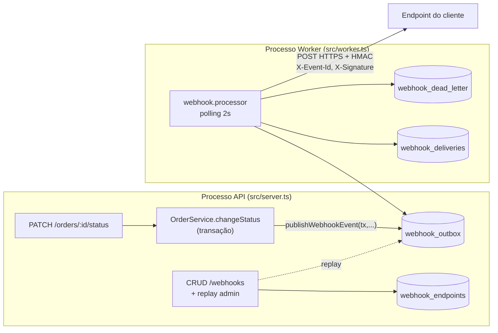

# RFC-001 — Sistema de Webhooks de Notificação de Pedidos

## 1. Metadados

| Campo | Valor |
|---|---|
| **Autora** | Larissa (Tech Lead), responsável por abrir o documento de design ([09:50] Larissa) |
| **Redação** | Michel Spirlandeli, com apoio de IA (ver [README](../README.md)) |
| **Status** | Em revisão |
| **Data** | 2026-11-16 |
| **Revisores** | Marcos (PM), Bruno (Eng. Pleno, Pedidos), Diego (Eng. Sênior, Plataforma), Sofia (Eng. de Segurança) |
| **Revisão obrigatória** | Sofia: revisão de segurança de pelo menos 2 dias úteis antes do deploy ([09:46] Sofia) |
| **Prazo estimado** | 3 sprints, incluindo a revisão de segurança ([09:47] Larissa) |
| **Documentos** | [PRD](PRD.md) · [FDD](FDD.md) · [ADRs](adrs/README.md) · [TRACKER](TRACKER.md) |

## 2. Resumo executivo (TL;DR)

Propomos notificar clientes B2B por **webhooks de saída** sempre que o status de um pedido muda. O evento é gravado numa **tabela outbox no MySQL**, na **mesma transação** da mudança de status. Um **worker em processo separado** lê a outbox **a cada 2 segundos** e faz um POST assinado com **HMAC-SHA256** (secret por endpoint) para a URL HTTPS do cliente.

Falhas são retentadas **5 vezes com intervalos crescentes (1m → 12h)**. Esgotadas as tentativas, o evento vai para uma **DLQ em tabela separada**, com replay manual por ADMIN. A garantia é **at-least-once**, e o cliente deduplica por **`X-Event-Id`**.

Não há infraestrutura nova: tudo roda sobre o MySQL, o Prisma e os padrões já existentes no OMS.

## 3. Contexto e problema

Três clientes B2B (Atlas Comercial, MaxDistribuição e Nova Cargo) pediram formalmente para serem notificados quando o status dos pedidos muda. Hoje eles fazem polling em `GET /orders`, o que deixa a integração "lenta e cara". A Atlas sinalizou que pode migrar para um concorrente se a entrega não sair até o fim do trimestre ([09:00] Marcos). Para eles, "tempo real" é **menos de 10 segundos** ([09:02] Marcos).

No código, a mudança de status é feita por `OrderService.changeStatus` ([src/modules/orders/order.service.ts](../src/modules/orders/order.service.ts)), numa transação que atualiza `orders`, grava `order_status_history` e mexe no estoque. A aplicação **não tem nenhum mecanismo de eventos, fila ou notificação externa**.

**O problema arquitetural:** como emitir notificações confiáveis para sistemas externos, que podem estar lentos ou fora do ar, **sem** comprometer a latência e a consistência da transação de pedidos ([09:04] Bruno)?

## 4. Objetivos e não-objetivos

**Objetivos**

- Notificar mudanças de status com latência abaixo de 10s no caminho feliz.
- Nunca haver mudança de status confirmada sem evento correspondente, nem evento sem mudança.
- Permitir ao cliente verificar autenticidade e integridade de cada chamada.
- Tolerar indisponibilidades do cliente de até ~15h sem perder eventos.

**Não-objetivos nesta fase** (detalhe no [PRD §5](PRD.md#5-escopo))

- Webhooks de entrada ([09:02] Marcos).
- Alerta ao cliente por e-mail ([09:37] Larissa).
- Dashboard visual ([09:40] Larissa).
- Ordenação global ([09:13] Larissa).
- Múltiplos workers ([09:13] Diego).
- Arquivamento da outbox ([09:08] Diego).

## 5. Proposta técnica

A proposta tem cinco blocos, cada um ancorado num ADR:

1. **Captura transacional (outbox).** Dentro de `changeStatus`, a função `publishWebhookEvent(tx, order, from, to)` seleciona os webhooks ativos do customer que assinam o `to_status` e insere um evento por endpoint em `webhook_outbox`, com o payload já renderizado. Se a inserção falha, a mudança de status sofre rollback. Ver [ADR-001](adrs/ADR-001-outbox-no-mysql.md) e [ADR-007](adrs/ADR-007-payload-snapshot-na-insercao.md).
2. **Entrega assíncrona (worker).** Um processo Node separado (`npm run worker`), com PrismaClient próprio, faz polling a cada 2s, pega um lote pequeno de eventos pendentes em ordem de criação e entrega um a um, com timeout de 10s. Ver [ADR-002](adrs/ADR-002-worker-separado-em-polling.md).
3. **Resiliência (retry e DLQ).** Falhas são reagendadas em 1m, 5m, 30m, 2h e 12h. Depois disso o evento vai para `webhook_dead_letter`, de onde um ADMIN pode reenfileirá-lo. Ver [ADR-003](adrs/ADR-003-retry-backoff-e-dlq.md).
4. **Segurança.** HMAC-SHA256 do corpo no header `X-Signature`, secret única por endpoint gerada pela plataforma, rotação com 24h de convivência, URL obrigatoriamente HTTPS e payload máximo de 64KB. Ver [ADR-004](adrs/ADR-004-hmac-sha256-com-secret-por-endpoint.md).
5. **Contrato de entrega.** At-least-once, com `X-Event-Id` estável entre retries e `X-Webhook-Id` identificando o cadastro. Ver [ADR-005](adrs/ADR-005-entrega-at-least-once-com-x-event-id.md).

O módulo `src/modules/webhooks` segue integralmente os padrões do projeto: camadas, `AppError` com códigos `WEBHOOK_*`, Pino, Zod e `requireRole` ([ADR-006](adrs/ADR-006-reuso-dos-padroes-do-projeto.md)). A superfície de API é um CRUD de configuração, a rotação de secret, o histórico de entregas e o replay administrativo. Os contratos completos estão no [FDD §8](FDD.md#8-contratos-públicos).

## 6. Alternativas consideradas

| # | Alternativa | Por que foi descartada (trade-off) | Origem |
|---|---|---|---|
| ALT-1 | **Disparo HTTP síncrono em `changeStatus`** | Acopla a latência e a disponibilidade do cliente à transação de pedidos. Um cliente lento trava a mudança de status de outros pedidos, e um cliente fora do ar forçaria um rollback absurdo. Ganharia simplicidade e latência, mas perderia robustez. | [09:04] Bruno, [09:06] Diego |
| ALT-2 | **Fila externa (Redis Streams)** | Seria um broker de verdade, com consumo reativo e escalável, mas exigiria subir e operar mais infraestrutura. Para um time pequeno, é overengineering. A outbox no MySQL resolve com atomicidade nativa. | [09:07] Larissa, [09:07] Diego |
| ALT-3 | **Trigger de banco para notificar o worker** | Reduziria a latência de detecção, mas o MySQL não tem LISTEN/NOTIFY, e uma trigger não notifica processo externo. Polling de 2s já cumpre o requisito de 10s. | [09:09] Bruno, [09:09] Diego |
| ALT-4 | **Exactly-once** | Evitaria a deduplicação no cliente, mas exige coordenação dos dois lados e muito mais complexidade. At-least-once com `event_id` resolve "99% dos casos". | [09:25] Diego |
| ALT-5 | **Retry indefinido / 3 tentativas** | Retry indefinido deixa eventos pendurados para sempre. Três tentativas cobrem só ~30min, insuficiente para manutenções de 2h já observadas. | [09:15] Diego, [09:16] Bruno, [09:16] Diego |
| ALT-6 | **Secret global** | Seria mais simples de gerir, mas um vazamento comprometeria todos os clientes. | [09:21] Sofia |

## 7. Questões em aberto

| # | Questão | Situação | Origem |
|---|---|---|---|
| Q-1 | **Rate limiting de envio por cliente.** 50 mudanças em um minuto geram 50 chamadas. | Fora do escopo: "observar e decidir depois". O FDD registra o volume por endpoint para embasar a decisão. | [09:38] Diego, [09:39] Larissa |
| Q-2 | **`customer_id` no body ou no path?** | Não decidido. O FDD propõe `customerId` no body do `POST` e como query param no `GET`, para manter as rotas sob `/webhooks`. | [09:32] Larissa |
| Q-3 | **Escala horizontal do worker** (particionar por `order_id` ou lock pessimista) | Adiada. Hoje é single-worker. | [09:13] Diego |
| Q-4 | **Endurecer a autorização do CRUD.** Hoje qualquer usuário autenticado pode configurar webhooks de **qualquer** customer, porque `User` não tem vínculo com `Customer` em [prisma/schema.prisma](../prisma/schema.prisma). | Adiada na reunião ("mais pra frente a gente pode endurecer"). **Recomendação da revisão, severidade alta:** tratar como pré-condição antes de dar a usuários de clientes acesso a esta API. Exige vincular `User` a `Customer`, o que está fora deste escopo ([FDD §11.3](FDD.md#113-isolamento-entre-clientes)). | [09:37] Sofia |
| Q-5 | **Assinatura durante o grace period de rotação.** Assinar com a nova, a antiga ou ambas? | Proposta no FDD: enviar as duas assinaturas. **Precisa de validação da Sofia.** | Lacuna de [09:21] Sofia |
| Q-6 | **Ordem por pedido sob retry.** A garantia de [09:12] só vale no caminho feliz: um evento em backoff pode ser ultrapassado por um evento posterior do mesmo pedido. | Aceitar como limitação documentada (o cliente usa `timestamp` e `from_status`) ou bloquear eventos posteriores do mesmo pedido? | Análise de [09:12] Diego e [09:15] Diego |
| Q-7 | **Evento na criação do pedido** (`null → PENDING`, gravado em `create()`) | A reunião só tratou de mudanças de status. A proposta é não emitir nesta fase. | Código: `order.service.ts#create` |
| Q-8 | **Criptografia da secret em repouso** | Não discutida. Proposta da revisão: AES-256-GCM com chave fora do banco ([FDD §11.2](FDD.md#112-secret-em-repouso)). Pauta da revisão de segurança. | [09:46] Sofia |
| Q-9 | **SSRF: URL cadastrada apontando para a rede interna** (`127.0.0.1`, `169.254.169.254`, IP privado, DNS rebinding). Exigir HTTPS não impede isso. | **Severidade crítica.** Não discutida na reunião. Proposta da revisão: validação no cadastro e no envio, IP pinning, sem redirects, e regra de egress ([FDD §11.1](FDD.md#111-proteção-contra-ssrf-severidade-crítica)). | Lacuna de [09:19] Sofia |
| Q-10 | **Retry por status HTTP:** 400, 401 e 404 deveriam ser retentados? E 429 com `Retry-After`? | Hoje toda resposta não-2xx é retentável, por simplicidade. A reunião só tratou do timeout. | Lacuna de [09:42] Diego |
| Q-11 | **Versionamento do payload** congelado na outbox | Não discutido. Os campos do payload foram fixados em [09:43], então nenhum campo de versão foi acrescentado. | Lacuna de [09:52] Larissa |

## 8. Impacto e riscos

**Impacto nos sistemas**

- **Transação de pedidos:** passa a ter um `SELECT` e um `INSERT` a mais, e uma falha nessa inserção bloqueia a mudança de status (intencional).
- **Banco:** quatro tabelas novas, polling a cada 2s e crescimento contínuo da outbox (arquivamento fora de escopo).
- **Operação:** um processo novo para implantar e monitorar.
- **Clientes:** precisam validar o HMAC e deduplicar por `X-Event-Id` (Marcos documenta no portal, [09:26] Marcos).

| Risco | Prob. | Impacto | Mitigação |
|---|---|---|---|
| Worker parado sem ninguém perceber, com eventos acumulando | Média | Alto | Alerta de idade do evento `PENDING` mais antigo ([FDD §12](FDD.md#12-observabilidade)) |
| Cliente lento bloqueia a fila de todos (single-worker e timeout de 10s) | Média | Médio | Timeout de 10s ([09:42] Diego), métrica de latência por endpoint, revisitar Q-3 |
| Vazamento de secret | Baixa | Alto | Secret por endpoint, rotação, `redact` no logger ([ADR-004](adrs/ADR-004-hmac-sha256-com-secret-por-endpoint.md)) |
| Cliente processa evento em duplicidade | Média | Médio | `X-Event-Id` e documentação ([ADR-005](adrs/ADR-005-entrega-at-least-once-com-x-event-id.md)) |
| Prazo de 3 sprints contra o "fim de novembro" da Atlas | Média | Alto | Escopo fechado e revisão de segurança já agendada ([09:46] Sofia) |
| **SSRF** pelo worker a partir de uma URL cadastrada | Média | Crítico | Q-9 / [FDD §11.1](FDD.md#111-proteção-contra-ssrf-severidade-crítica) |
| Usuário de um cliente acessa webhooks de outro cliente | Média | Alto | Q-4 / [FDD §11.3](FDD.md#113-isolamento-entre-clientes) |

## 9. Decisões relacionadas

| ADR | Decisão |
|---|---|
| [ADR-001](adrs/ADR-001-outbox-no-mysql.md) | Outbox no MySQL na mesma transação |
| [ADR-002](adrs/ADR-002-worker-separado-em-polling.md) | Worker separado, polling 2s, single-worker |
| [ADR-003](adrs/ADR-003-retry-backoff-e-dlq.md) | Retry 1m/5m/30m/2h/12h e DLQ separada com replay ADMIN |
| [ADR-004](adrs/ADR-004-hmac-sha256-com-secret-por-endpoint.md) | HMAC-SHA256 com secret por endpoint e rotação de 24h |
| [ADR-005](adrs/ADR-005-entrega-at-least-once-com-x-event-id.md) | At-least-once com `X-Event-Id` |
| [ADR-006](adrs/ADR-006-reuso-dos-padroes-do-projeto.md) | Reuso dos padrões do projeto |
| [ADR-007](adrs/ADR-007-payload-snapshot-na-insercao.md) | Payload snapshot na inserção |
